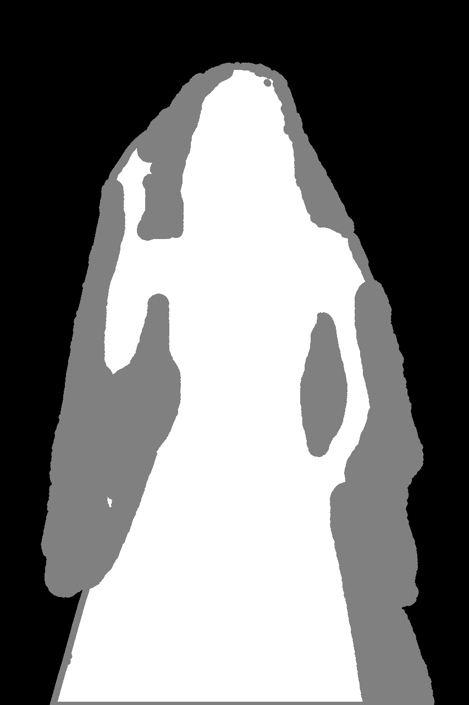
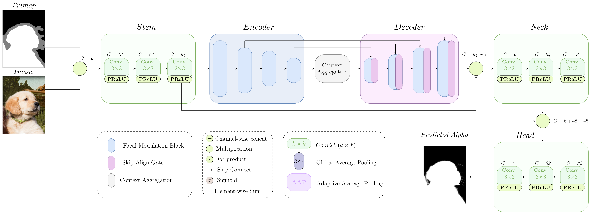
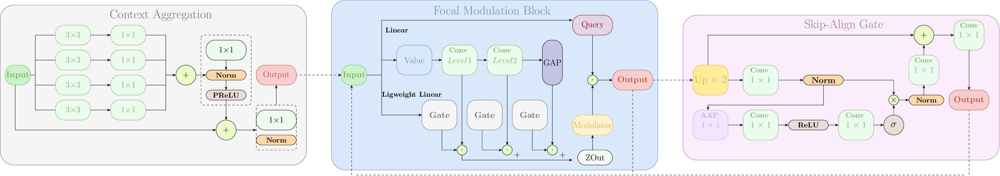

# FocalMatter

Official implementation of [**FocalMatter: State-of-the-art Image Matting with Focal Modulation Blocks** [SSRN 2026]](https://papers.ssrn.com/sol3/Delivery.cfm/ec35457c-476a-4742-a8c7-bcbd85b50117-MECA.pdf?abstractid=7153802&mirid=1)

FocalMatter is a trimap-guided natural image matting network. It combines a FocalNet encoder with a compact U-shaped decoder to predict high-quality alpha mattes from an RGB image and a trimap. The model uses focal modulation for multi-scale context reasoning while keeping the decoder lightweight for high-resolution matting.

| Input image | Trimap | Predicted alpha |
| --- | --- | --- |
|  |  |  |

## Architecture





## Highlights

- FocalNet-based hierarchical encoder with an adapted image-plus-trimap input stem.
- Lightweight U-shaped decoder with decoder widths `512, 256, 128, 64`.
- Depthwise-dilated top-level context aggregation with rates `1, 2, 4, 8`.
- Skip-Align Gate blocks for channel alignment and selective skip fusion.
- FocalRefine blocks that reuse focal modulation in the decoder.
- Single-pass trimap-guided inference with optional padding to stride-compatible sizes.

## Results

Reported Adobe Composition-1K results from the paper:

| Method | SAD | MSE | Grad | Conn |
| --- | ---: | ---: | ---: | ---: |
| **FocalMatter** | **17.24** | 2.46 | **4.25** | **12.10** |

Lower is better for all metrics.


## Installation

Create an environment and install the project requirements:

```shell
pip install -r requirements.txt
```

For GPU evaluation, install a PyTorch build that matches your CUDA version before running the scripts.

## Checkpoints

Download the required model files from these links:

| Model file | Download link | Purpose |
| --- | --- | --- |
| FocalMatter checkpoint | [Google Drive](https://drive.google.com/file/d/1jtoX7YpW5qxb6XQTnUwGhRQxBJ7NDhnC/view?usp=sharing) | Trained FocalMatter weights for evaluation/inference. |
| FocalNet-Tiny SRF pretrained encoder | [Microsoft FocalNet GitHub release](https://github.com/microsoft/FocalNet/releases/download/v1.0.0/focalnet_tiny_srf.pth) | Initial ImageNet pretrained encoder weights. |

After downloading, set `ModelConfig.checkpoint_path` and `ModelConfig.encoder_weights_path` in `utils/config.py` to the locations where you saved the files.

## Data Preparation

The paper training setup uses foregrounds and alpha mattes from Adobe Composition-1K and background images such as MS COCO.

Edit the default dataset paths in `utils/config.py` before running evaluation or visualisation workflows that depend on local data.

## Training

The full training script and reproducible training recipe will be provided once the paper is accepted. This release focuses on checkpoint-based evaluation, inference, and architecture visualisations.

## Evaluation

Set `EvalConfig` and `ModelConfig.checkpoint_path` in `utils/config.py`, then run:

```powershell
python eval.py
```

The evaluator loads the configured checkpoint, predicts alpha mattes, writes outputs when `EvalConfig.write_outputs` is enabled, and reports SAD and MSE. When `EvalConfig.full_metrics` is enabled, it also reports gradient and connectivity errors.


Architecture diagrams and activation visualizations are stored under `paper/figures/`, `assets/`, and `visualisations/`.

## Citation

If you use this repository or paper, please cite:

```bibtex
@article{cvetkov2026focalmatter,
  title     = {FocalMatter: A Novel Focal Modulation-Based Network for Image Matting},
  author    = {Cvetkov, Kiril and Madevska Bogdanova, Ana and Jovanov, Mile and Ackovska, Nevena},
  journal   = {SSRN Electronic Journal},
  year      = {2026},
  doi       = {10.2139/ssrn.7153802},
  url       = {https://ssrn.com/abstract=7153802}
}
```


## License

This repository is released under the GNU Affero General Public License v3.0. See `LICENSE` for details. Upstream pretrained weights and external datasets may have separate licenses or usage terms.
